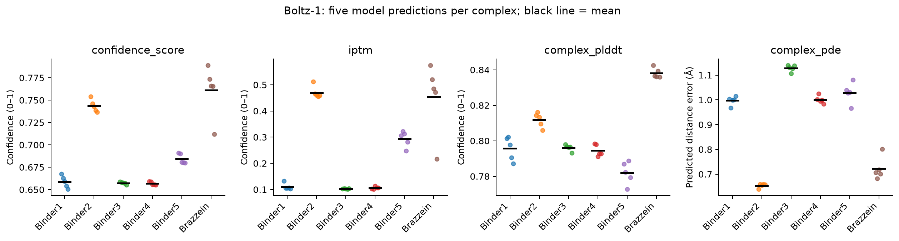
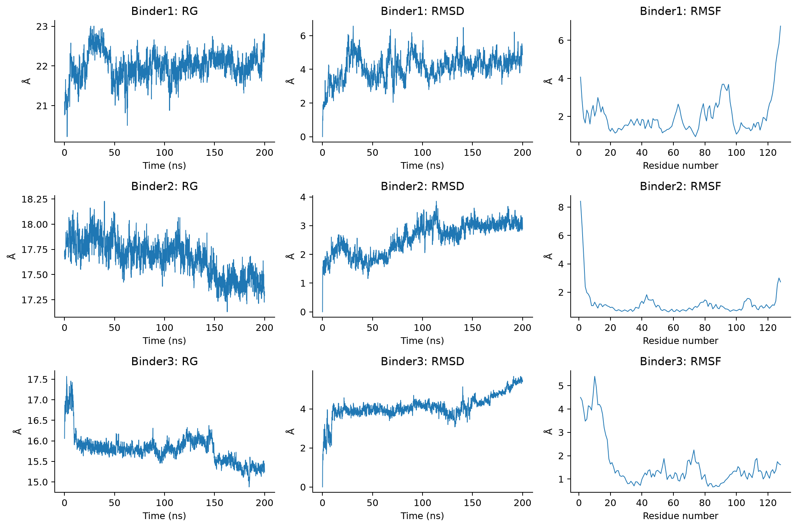
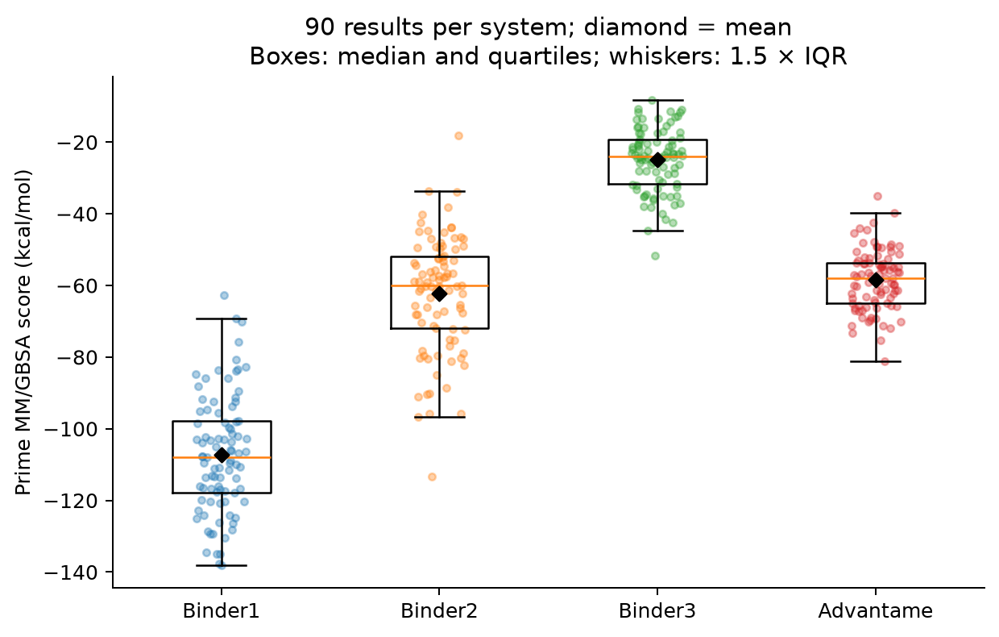

# Sweet modulator design

A compact research companion for **De novo design of protein binders targeting the human sweet taste receptor as potential sweet proteins**, Saisai Ding and Yi Zhang, *npj Science of Food* (2026). [Article / DOI](https://doi.org/10.1038/s41538-026-01202-x).

This study explores 128-residue protein binders to the extracellular region of human TAS1R2. RFdiffusion backbone generation and ProteinMPNN–FastRelax sequence design were followed by Boltz-1 prediction, static GBSA screening and molecular dynamics of three selected complexes. The repository shares selected structures, basic analysis tables, figures and the computational workflow. It is a curated companion, not a complete reconstruction of the original 5,000-backbone campaign.

**The designs are computational candidates. Receptor binding, receptor activation and perceived sweetness are distinct outcomes; these calculations do not establish experimental sweetness.**

## What the available data show

| Evidence | Main observation | Interpretation |
| --- | --- | --- |
| Five Boltz-1 predictions per complex | Binder2 mean ipTM 0.471; brazzein reference 0.454 | Binder2 has the strongest interface confidence among the five designs, although its absolute ipTM is modest |
| Static Uni-GBSA values | Binder1 −115.62 kcal/mol | Most favorable static score among the five designs |
| Trajectory MM/GBSA, 90 saved results per system | Binder1 −107.21 ± 16.36; Binder2 −62.35 ± 16.28; Binder3 −24.94 ± 8.77; advantame −58.53 ± 8.38 kcal/mol | Descriptive mean ± sample SD; these scores are not measured affinities |
| MD structure and interface analyses | Different stability and contact patterns for Binder1–3 | Complementary evidence for prioritization, rather than one universal ranking |

The Boltz ensemble members and MD snapshots are not independent experimental replicates. Static Uni-GBSA and trajectory Prime MM/GBSA use different workflows and must not be pooled as one energy scale. The small-molecule reference also differs substantially in size from the protein binders.







## Contents

- [Computational workflow and parameters](docs/WORKFLOW.md)
- [Article-to-data map, units and interpretation](docs/DATA_GUIDE.md)
- [Boltz model-level table](data/boltz/metrics.csv): 30 predictions, five per design/reference.
- [Representative complex structures](structures/) and [five binder sequences](structures/design_sequences.fasta).
- [MD analysis tables](data/md/) and [static / trajectory energies](data/energies/).
- [Descriptive summaries](data/summary/) and [selected figures](figures/).
- [Source file mapping and SHA-256 hashes](provenance/source_manifest.json).

## Regenerate the lightweight summaries

```bash
python -m pip install -r requirements.txt
python analysis/summarize.py
```

This only reads the included CSVs and redraws the descriptive plots. It does not run protein design, structure prediction or MD. The original Binder1 interaction scripts are included under [analysis/reference_scripts](analysis/reference_scripts/) to document how contacts and interface area were defined; running them requires Schrödinger and the original trajectories, which are not included.

## Scope and attribution

Binder1–3 have 200-ns analysis tables. The article describes a 300-ns advantame reference; the exported structural curves actually extend to 303.652854 ns despite the historical source folder name containing `500ns`. Advantame contact tables cover 20.0004–199.903998 ns. Common structural comparisons should use 0–200 ns, and matched contact comparisons must respect the shorter available window; energy jobs targeted 20–200 ns. Large trajectories, simulation binaries, checkpoints, duplicated images and the publisher PDF are omitted.

The existing repository MIT [license](LICENSE) is retained. The linked article carries its own publisher license (CC BY-NC-ND 4.0); the article PDF is not redistributed or relicensed here. Figures copied from the research directory are identified in the source manifest; the three overview plots above are newly rendered from the supplied numerical tables.
